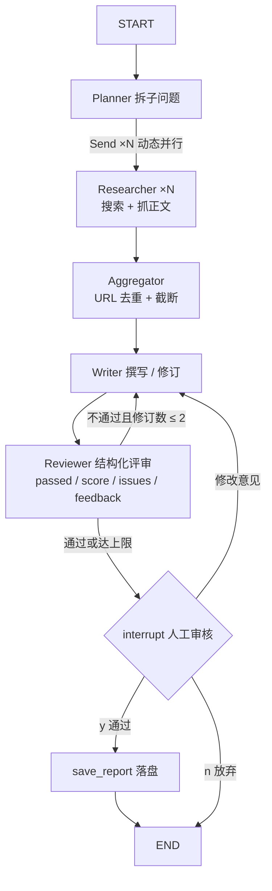

# 深度调研 Agent（Deep Research）

输入一个调研主题，自动完成「规划 → 多路检索 → 撰写」，输出一份带来源引用的 Markdown 调研简报。

- 当前进度：**M2 已就绪**（LangGraph 多智能体：并行检索 + 评审回退 + 人工审核）
- 里程碑：~~M2 多智能体（LangGraph）~~ → M3 评测与可观测

---

## 一、运行环境（已配置完成）

| 项 | 值 |
|---|---|
| 项目位置 | 桌面 `深度调研 Agent」（Deep Research）` |
| Python | 3.13（`.venv` 虚拟环境已创建） |
| 依赖 | 已安装，清单见 `requirements.txt` |

### 在 PyCharm 中打开

1. `File → Open`，选择本项目文件夹
2. 配置解释器：`File → Settings → Project → Python Interpreter → Add Interpreter → Add Local Interpreter → Existing`，选择
   `.venv\Scripts\python.exe`
3. 新建运行配置：`Run → Edit Configurations → + → Python`
   - Script path：`main.py`
   - Parameters：`"2026 年 AI Agent 行业现状"`（换成你想调研的主题）
4. 点击运行

---

## 二、配置 API Key（第一次运行前必做）

把 `.env.example` 复制为 `.env`（注意文件名开头有个点），填入任意 OpenAI 兼容接口的 Key：

- **DeepSeek**（推荐，便宜）：https://platform.deepseek.com
- OpenAI / Kimi / 通义 等：改 `OPENAI_BASE_URL` 和 `MODEL_NAME` 即可（模板里有示例）

> 搜索默认走免费的 DuckDuckGo；配置 `TAVILY_API_KEY` 后自动切换到更稳定的 Tavily。

---

## 三、命令行运行

```bash
# 1. 检查环境（依赖 + 配置 + 真实连通性测试）
.venv\Scripts\python.exe main.py --check

# 2. 跑一次调研（默认 M2：LangGraph 多智能体）
.venv\Scripts\python.exe main.py "你的调研主题"

# 3. 非交互运行：人工审核自动通过（脚本 / CI 用）
.venv\Scripts\python.exe main.py --yes "你的调研主题"

# 4. 对照跑 M1 顺序流程
.venv\Scripts\python.exe main.py --m1 "你的调研主题"
```

M2 流程中 Reviewer 评审通过后，会**暂停等待人工审核**：输入 `y` 保存报告、输入修改意见退回 Writer 重写、输入 `n` 放弃。

> 注意：**必须用 `.venv\Scripts\python.exe` 运行**。直接用系统 `python` 会报 `ModuleNotFoundError: No module named 'rich'`。
> `--check` 的输出第 0 行会打印当前解释器路径，一眼就能看出是否用错了 Python。

生成的报告保存在 `outputs/` 目录。

---

## 四、目录结构

```
├── main.py                # 命令行入口（--check / "主题" / --m1 "主题"）
├── requirements.txt       # 依赖清单
├── .env.example           # 环境变量模板（复制为 .env 使用）
├── src/
│   ├── config.py          # 配置读取
│   ├── llm.py             # LLM 客户端（超时 + 重试 + 退避抖动）
│   ├── tools.py           # 工具：搜索（Tavily/DuckDuckGo）+ 网页抓取
│   ├── utils.py           # JSON 解析等小工具
│   ├── pipeline.py        # M1 主流程（顺序执行，对照用）
│   ├── graph.py           # M2 主流程（LangGraph 多智能体图）
│   └── agents/
│       ├── planner.py     # Planner：拆解检索子问题
│       ├── researcher.py  # Researcher：搜集资料 + 抓正文（M2 中并行执行）
│       ├── writer.py      # Writer：整合成带引用简报（支持带反馈修订）
│       └── reviewer.py    # Reviewer：5 维 rubric 结构化评审（M2 新增）
└── outputs/               # 生成的报告（已 gitignore）
```

---

## 五、M2 架构（LangGraph 多智能体）



**设计要点：**

- **四种模式组合**：Chaining（主链路）+ Parallelization（`Send` 动态并行检索）+ Evaluator-Optimizer（Writer↔Reviewer 回退修订）+ 人工介入（`interrupt`）
- **有界自主**：回退修订上限 `MAX_REVISIONS=2`（.env 可配），超限强制转人工；图执行 `recursion_limit=50` 兜底
- **优雅失败**：搜索/抓取失败不抛异常，空证据也能走完全程并如实说明
- **LLM 调用加固**：60s 超时 + 2 次重试（指数退避 + 抖动）

---

## 六、路线图（面试叙事线）

- [x] **M1** 顺序流程：Plan → Research → Write
- [x] **M2** 升级 LangGraph 多智能体：Planner / Researcher（并行）/ Writer / Reviewer + 回退修订 + 人工介入
- [ ] **M3** 评测与可观测：自建评测集 + Langfuse 接入 + README 架构图与演示

---

## 七、常见问题

| 问题 | 解决 |
|---|---|
| 报错"未找到 OPENAI_API_KEY" | 还没创建 `.env`，见上文第二部分 |
| 搜索一条都搜不到 | 检查是否配了 `TAVILY_API_KEY`（DuckDuckGo 在国内网络常被限流）；跑 `main.py --check` 看第 3 节连通性测试结果 |
| 报 `ModuleNotFoundError: No module named 'rich'` | 用错解释器了，改用 `.venv\Scripts\python.exe`，或在 PyCharm 里把解释器切到 `.venv` |
| 运行到一半"卡住不动" | 正常现象：M2 在人工审核处等待输入（`y` / 修改意见 / `n`）。不想交互就加 `--yes` |
| 填了 key 还是不生效 | 确认填的是项目根目录的 `.env`（不是 `.env.example`），填完保存后再跑 `main.py --check` 验证 |
| 换了电脑 / 依赖丢失 | 重新执行 `.venv\Scripts\python.exe -m pip install -r requirements.txt` |
| PyCharm 找不到 `.venv` | 手动指定解释器路径（见上文第一步） |
