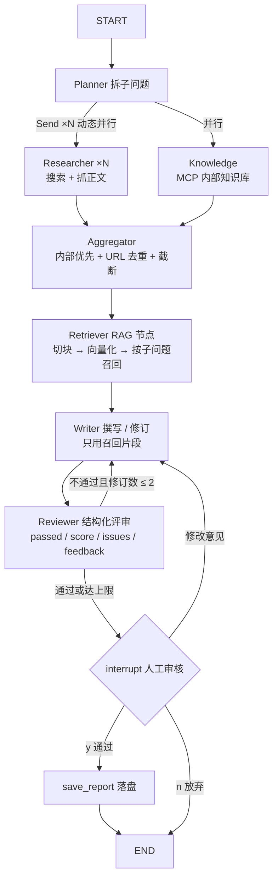

# 深度调研 Agent（Deep Research）

输入一个调研主题，自动完成「规划 → 多路检索 → 撰写」，输出一份带来源引用的 Markdown 调研简报。

- 当前进度：**M3 已就绪**（评测体系 + 可观测追踪：20 条评测集 / LLM-as-Judge / 运行级 trace / Langfuse 预留接入）
- 里程碑：~~M2 多智能体（LangGraph）~~ → ~~M3-RAG 检索增强~~ → ~~M3 评测与可观测~~

---

## 一、运行环境（已配置完成）

| 项      | 值                               |
| ------ | ------------------------------- |
| 项目位置   | 桌面 `深度调研 Agent」（Deep Research）` |
| Python | 3.13（`.venv` 虚拟环境已创建）           |
| 依赖     | 已安装，清单见 `requirements.txt`      |

### 在 PyCharm 中打开

1. `File → Open`，选择本项目文件夹
2. 配置解释器：`File → Settings → Project → Python Interpreter → Add Interpreter → Add Local Interpreter → Existing`，选择  
   `.venv\Scripts\python.exe`
3. 新建运行配置：`Run → Edit Configurations → + → Python`
   - Script path：`main.py`
   - Parameters：`"2026 年 AI Agent 行业现状"`（换成你想调研的主题）
4. 点击运行

---

## 二、配置 API Key（第一次运行前必做）

把 `.env.example` 复制为 `.env`（注意文件名开头有个点），填入任意 OpenAI 兼容接口的 Key：

- **DeepSeek**（推荐，便宜）：<https://platform.deepseek.com>
- OpenAI / Kimi / 通义 等：改 `OPENAI_BASE_URL` 和 `MODEL_NAME` 即可（模板里有示例）

> 搜索默认走免费的 DuckDuckGo；配置 `TAVILY_API_KEY` 后自动切换到更稳定的 Tavily。

---

## 三、命令行运行

```bash
# 1. 检查环境（依赖 + 配置 + 真实连通性测试）
.venv\Scripts\python.exe main.py --check

# 2. 跑一次调研（默认 M2：LangGraph 多智能体）
.venv\Scripts\python.exe main.py "你的调研主题"

# 3. 非交互运行：人工审核自动通过（脚本 / CI 用）
.venv\Scripts\python.exe main.py --yes "你的调研主题"

# 4. 对照跑 M1 顺序流程
.venv\Scripts\python.exe main.py --m1 "你的调研主题"

# 5. 评测：跑 N 条主题（默认 5），产出质量报告与逐题数据
.venv\Scripts\python.exe main.py --eval          # 抽前 5 条
.venv\Scripts\python.exe main.py --eval --all    # 全量 20 条
.venv\Scripts\python.exe main.py --eval --compare  # 同题加跑 M1 对照

# 6. MCP 自检：连接知识库服务、列出工具、调一次检索、演示参数校验（不跑 LLM，几秒）
.venv\Scripts\python.exe main.py --mcp
.venv\Scripts\python.exe main.py --mcp "混合检索和重排的区别"
```

M2 流程中 Reviewer 评审通过后，会**暂停等待人工审核**：输入 `y` 保存报告、输入修改意见退回 Writer 重写、输入 `n` 放弃。

> 注意：**必须用 `.venv\Scripts\python.exe` 运行**。直接用系统 `python` 会报 `ModuleNotFoundError: No module named 'rich'`。  
> `--check` 的输出第 0 行会打印当前解释器路径，一眼就能看出是否用错了 Python。

生成的报告保存在 `outputs/` 目录。

---

## 四、目录结构

```
├── main.py                # 命令行入口（--check / "主题" / --yes / --m1 / --mcp / --eval [N]）
├── requirements.txt       # 依赖清单
├── .env                   # 环境变量（含 Key，已 gitignore）
├── bge-small-zh-v1.5/     # 本地嵌入模型（已 gitignore，见第五节说明）
├── evals/
│   ├── dataset.json       # 评测集：20 条主题 + 应覆盖要点清单
│   └── baselines/
│       ├── baseline.json  # 当前基线（入库，每次评测自动回归对比）
│       └── history/       # 历史基线（时间戳副本）
├── src/
│   ├── config/                # ① 配置层：参数与环境变量的唯一出口
│   │   └── settings.py        # 从 .env 读取并做类型转换（含 MCP 连接参数）
│   ├── core/                  # ② 抽象接口层：只放契约（ABC），不含实现
│   │   ├── llm_client.py      # BaseLLMClient：LLM 客户端接口
│   │   ├── vector_store.py    # BaseVectorStore：向量库接口
│   │   └── reranker.py        # BaseReranker：重排器接口
│   ├── modules/               # ③ 具体实现层：实现 core 的契约
│   │   ├── llm.py             # OpenAI 兼容客户端（超时 + 重试 + 退避抖动 + trace）
│   │   ├── tools.py           # 工具：搜索（Tavily/DuckDuckGo）+ 网页抓取
│   │   ├── mcp_client.py      # MCP Client：stdio 传输 + 常驻会话 + 同步外观（供 LangGraph 节点用）
│   │   ├── tracing.py         # 可观测：运行级 trace（节点/LLM/汇总）+ Langfuse 上报
│   │   ├── chunking.py        # 段落感知分块（500 字 + 80 字重叠）
│   │   ├── embedder.py        # 本地 BGE 嵌入（bge-small-zh-v1.5，512 维）
│   │   ├── vectorstore.py     # 向量索引 + 余弦检索（含 BM25 降级）
│   │   └── agents/
│   │       ├── planner.py     # Planner：拆解检索子问题
│   │       ├── researcher.py  # Researcher：搜集资料 + 抓正文（M2 中并行执行）
│   │       ├── knowledge.py   # Knowledge：经 MCP 查内部知识库（动态发现工具 + 降级）
│   │       ├── writer.py      # Writer：整合成带引用简报（支持带反馈修订）
│   │       └── reviewer.py    # Reviewer：5 维 rubric 结构化评审
│   ├── services/              # ④ 业务编排层：把检索 / 重排 / 生成串起来
│   │   ├── pipeline.py        # M1 主流程（顺序执行，对照用）
│   │   ├── graph.py           # M2 主流程（LangGraph 多智能体图 + RAG 节点）
│   │   ├── retriever.py       # RAG 检索编排：建索引 → 按子问题召回 → 聚合证据
│   │   └── evals/
│   │       ├── judge.py       # LLM-as-Judge 独立评审（与环内 Reviewer 分离）
│   │       └── runner.py      # 批量评测 → 确定性指标 + 评审聚合报告
│   └── utils/                 # ⑤ 通用工具层
│       └── text.py            # JSON 解析等文本处理
└── outputs/               # 报告 / 评测产物 / traces（已 gitignore）
```

---

## 五、架构（LangGraph 多智能体 + RAG）



**设计要点（演进取舍）：**

- **五种模式组合**：Chaining（主链路）+ Parallelization（`Send` 动态并行检索）+ RAG（切块 / 向量化 / 语义召回）+ Evaluator-Optimizer（Writer↔Reviewer 回退修订）+ 人工介入（`interrupt`）
- **有界自主**：回退修订上限 `MAX_REVISIONS=2`（.env 可配），超限强制转人工；图执行 `recursion_limit=50` 兜底
- **优雅失败三层降级**：向量索引不可用 → BM25 关键词检索 → 全量资料拼接；搜索/抓取失败不抛异常，空证据也能走完全程并如实说明
- **LLM 调用加固**：60s 超时 + 2 次重试（指数退避 + 抖动）

### RAG 子系统（本地向量检索）

| 环节 | 实现                                                  | 参数（.env 可调）                           |
| -- | --------------------------------------------------- | ------------------------------------- |
| 分块 | 段落感知切分（句末标点优先），相邻块保留重叠                              | `CHUNK_SIZE=500` / `CHUNK_OVERLAP=80` |
| 嵌入 | 本地 bge-small-zh-v1.5（512 维，纯离线）；查询侧加 BGE 指令前缀做非对称检索 | `EMBEDDING_MODEL_PATH`                |
| 检索 | numpy 余弦相似度 Top-K，归一化后点积即相似度                        | `RAG_TOP_K=8` / `RAG_MIN_SCORE=0.35`  |
| 降级 | 模型缺失/加载失败 → BM25（标准库实现，中英混合粗切）                      | 自动                                    |
| 聚合 | 同一 URL 命中多片段合并为一条证据，保留最高分                           | 自动                                    |

**为什么索引不持久化**：调研信源是实时网页，持久化会把过期内容当成当前现状（脏数据风险），所以每次运行重建内存态索引。

**实测收益**（真实运行数据，已写入每份报告头部的 HTML 注释）：

- 运行一：8 个网页 → 105 片段 → 召回 5 条证据，上下文 38313 → 11314 字符（**省 70%**）
- 运行二：8 个网页 → 66 片段 → 召回 6 条证据，上下文 23426 → 9669 字符（**省 59%**）

**嵌入模型**：从 HuggingFace 下载 `BAAI/bge-small-zh-v1.5`（约 92MB），放到项目根目录的 `bge-small-zh-v1.5/` 文件夹即可（已 gitignore，不入库）。`RAG_ENABLED=false` 可整体关闭 RAG 退回全量拼接。

### MCP 工具层（knowledge 节点）

`planner` 之后分两路并行：`researcher` 走公网网页，`knowledge` 走 MCP。后者把 `rag-knowledge-chat` 的检索能力
（`search_knowledge` / `get_chunk` / `list_sources`）当外部工具用，命中片段转成与网页证据同构的 `Evidence`
（`url = mcp://rag-knowledge/<doc>#<pos>`），并入 aggregator 后与网页证据一起建 RAG 索引。

**动态发现的三层含义**（不是嘴上说说）：

1. 每次运行先 `tools/list`，按服务端**实际返回**的工具名选工具（精确名优先，退化到名字含 `search` 的）；
2. 按工具的 `input_schema` 过滤参数——服务端没声明 `top_k` 就不传，改名/删参数不会直接报错；
3. 按 `required` 校验必填项，缺了在本地就报错，不发注定被拒的请求。

**连接方式**：stdio，一条后台事件循环线程 + 一条常驻会话。LangGraph 节点是同步函数，
每次调用都起子进程意味着重新加载 FAISS 与嵌入模型（1~2s 冷启动），4 个子问题就是 4 次冷启动；
常驻会话把成本压到一次握手（实测 3 次检索共 1.8s）。同步外观由 `run_coroutine_threadsafe` 桥接，
多线程并发调用共享同一 session 是安全的（JSON-RPC 带 id，响应由 SDK 分发）。

**失败降级**（与 RAG 同一套契约）：连不上 / 服务端没这个工具 / 单次调用被拒，都只让这一路没有证据，图继续跑；
`mcp_stats` 记 `status / calls / hits / errors`，写进 trace 与报告头。会话级失败会断开并缓存失败原因，
后续子问题不再等超时。

| 环境变量 | 默认 | 说明 |
|---|---|---|
| `MCP_ENABLED` | `true` | 关掉后 knowledge 节点直接跳过 |
| `MCP_SERVER_CWD` | `../rag-knowledge-chat` | 服务端项目目录 |
| `MCP_SERVER_COMMAND` | 服务端 `.venv` 解释器 | 留空自动探测（服务端要 fastembed/faiss，不能用本项目的 venv） |
| `MCP_SERVER_ARGS` | `-m mcp_server` | stdio 启动参数 |
| `MCP_CONNECT_TIMEOUT` / `MCP_CALL_TIMEOUT` | 30 / 60 | 握手与单次调用超时（秒） |
| `MCP_TOP_K` / `MCP_MAX_EVIDENCE` / `MCP_MAX_QUERIES` | 3 / 3 / 3 | 检索预算：每问召回几条、最多并入几条、最多查几个子问题 |
| `MCP_STDERR` / `MCP_SERVER_LOG` | 落文件 | 服务端 stderr 默认写 `outputs/mcp_server.log`；`MCP_STDERR=inherit` 直接打屏 |

演示（不消耗 LLM token）：

```
$ python main.py --mcp
已连接 rag-knowledge v1.0.0（协议 2025-11-25）
tools/list：发现 3 个工具
│ search_knowledge │ query │ query, top_k, mode, rerank │ ...
调用 search_knowledge({'query': '混合检索和重排分别解决什么问题', 'top_k': 3})
   返回 3 条；索引后端 faiss:flat
   - rag-notes.md::3  score=0.0325  ...
参数校验（故意传 top_k=999，应被服务端拒绝）
   已拒绝 search_knowledge: ... Input should be less than or equal to 20 ...
```

一次真实运行的报告头会带上 MCP 统计：
`<!-- 评审得分: 9/10 | ... | RAG: embedding / 59 片段 / 命中 6 条 | MCP: ok / 调用 3 次 / 命中 3 条 -->`，
报告末尾「参考来源」另列「内部知识库」小节。

> MCP 与 Function Calling 的差别、stdio 与 HTTP+SSE 的取舍、工具 Schema 与凭据边界，见
> `rag-knowledge-chat/README.md` 的「MCP 服务端」章节。

---

## 六、评测与可观测（M3）

### 评测体系（`evals/` + `src/services/evals/`）

自建 20 条主题评测集（`evals/dataset.json`，领域混合：技术 / 行业 / 协议 / 安全 / 算力），
  
每条主题带「应覆盖要点清单」。指标分两层，刻意区分**可复现性**：

| 层          | 指标                           | 口径                         |
| ---------- | ---------------------------- | -------------------------- |
| 确定性（无 LLM） | 引用有效率                        | 正则校验 `[编号]` 是否落在 1~N 证据范围内 |
| 确定性        | 证据引用覆盖 / 证据数 / 报告长度          | 直接计数                       |
| 确定性        | RAG 上下文压缩率 / 耗时 / token / 重试 | 来自 trace                   |
| LLM 评审     | 覆盖度 / 忠实度 / 结构 / 洞察 + 总分     | LLM-as-Judge               |

**评审器独立性**：评测用的 Judge 与流水线内的 Reviewer 是两套 prompt、两个角色——
  
Reviewer 在环内反馈给 Writer 修订；Judge 在环外只打分，且拿着评测集的要点清单
  
逐项核对。避免"自己写的自己评"。

产物（`outputs/`）：`eval_report_*.md`（聚合报告）、`eval_results_*.json`（逐题明细）。

### 评测基线（回归对比）

基线存在 `evals/baselines/baseline.json`（**入库**），每次评测自动对比并输出升降：

```
=== 与基线对比 ===
    Judge 总分：8.2 → 8.0  ↓ -0.2
    单引用率：0.71 → 0.97  ↑ +0.26
    平均 token：15264 → 15786  ↑ +522
```

`--eval --baseline` 把本次结果设为新基线，旧基线自动进 `history/`
（评审口径变严时应重置基线，否则口径不同无法对比）。

**单引用率**：成串堆砌（如 `[1][2][3]`）无法定位到具体论断，所以"引用有效率 100%"
并不等于可追溯。该指标统计非成串引用占比，用来防止指标被堆砌刷满。

### 一次用数据做取舍的实例（2026-10-14）

同时改了两处，用同一批 5 条题验证，结论相反：

| 改动                                       | 实测                                                                              | 裁决   |
| ---------------------------------------- | ------------------------------------------------------------------------------- | ---- |
| Writer/Reviewer/Judge 加引用规范（一句一引、单论断 ≤ 2 编号） | 单引用率 0.71 → **0.97**，堆砌从每题 5~9 处降到 0~1 处                                          | 保留   |
| 信源预算 `MAX_PAGES` 8 → 12                  | 证据 7.4 → 7.2（**没涨**，被 `RAG_TOP_K=8` 召回上限卡住），token **+67%**、耗时 +65%                | 回滚   |

结论写进了 `src/config/settings.py` 的注释：真正的瓶颈不是"抓多少页"，而是"召回多少条"。

### 可观测（`src/modules/tracing.py`）

每次运行自动产出 trace 文件（`outputs/traces/run_*.json`），记录：

- **节点级**：各图节点耗时与关键产物（RAG 统计、评审得分、修订轮次、报告路径）
- **LLM 级**：每次调用的模型、延迟、输入/输出 token、重试次数、错误
- **运行级**：总耗时、token 汇总、运行状态

运行结束会在控制台打印摘要（`本次运行：耗时 · LLM 调用 · token · trace 路径`）。

**Langfuse 接入（可选，预留位）**：在 `.env` 中配置以下三项即自动开启上报
  
（Ingestion API 直连，无需安装 SDK；上报失败只告警不阻塞主流程）：

```
LANGFUSE_PUBLIC_KEY=pk-lf-...
LANGFUSE_SECRET_KEY=sk-lf-...
LANGFUSE_HOST=https://cloud.langfuse.com   # 自部署则改成自己的地址
```

未配置时一切照常，本地 trace 独立工作。`TRACE_ENABLED=false` 可整体关闭落盘。

---

## 七、演进路线

- [x] **M1** 顺序流程：Plan → Research → Write
- [x] **M2** 升级 LangGraph 多智能体：Planner / Researcher（并行）/ Writer / Reviewer + 回退修订 + 人工介入
- [x] **M3-RAG** 本地向量检索：bge-small-zh-v1.5 嵌入 + 分块索引 + 按子问题语义召回（上下文省 59%~70%）
- [x] **M3 评测与可观测**：20 条评测集 + LLM-as-Judge 独立评审 + 运行级 trace（Langfuse 可选接入）
- [x] **M4 MCP 工具层**：自建 stdio MCP Client（常驻会话）+ knowledge 节点接入内部知识库（动态发现工具、Schema 驱动传参、失败降级）

### 评测实测（5 条主题）

| 指标 | 首轮（引用规范改进前） | 当前基线（改进后） |
|---|---|---|
| 完成率 | 5/5（0 失败、0 评审解析失败） | 5/5 |
| Judge 总分 | 8.2/10（覆盖 8.8 / 忠实 8.2 / 结构 9.2 / 洞察 7.8） | 8.0（8.4 / 8.2 / 9.0 / 8.0） |
| 引用有效率 | 100%（257/257） | 100%（判据更严：新增一句一引检查） |
| 单引用率 | 0.71（回算得出） | **0.97** |
| RAG 上下文压缩 | 70%~75% | 75% |
| 平均耗时 / token | 37.5s / 15264 | 45.6s / 15786 |

> 复现：`.venv\Scripts\python.exe main.py --eval`；全量 20 条加 `--all`；M1 对照加 `--compare`；设为新基线加 `--baseline`。
> 说明：总分 8.2 → 8.0 的下降来自评审判据变严（结构维度新增"禁止成串堆砌"），并非质量退步；
> 5 条样本下 Judge 分数本身有 ±0.4 噪声。当前最弱维度是**覆盖度 8.4**，
> 瓶颈在 `RAG_TOP_K=8` 的召回上限，下一步做校准实验。

---

## 八、常见问题

| 问题                                              | 解决                                                                                    |
| ----------------------------------------------- | ------------------------------------------------------------------------------------- |
| 报错"未找到 OPENAI_API_KEY"                          | 还没创建 `.env`，见上文第二部分                                                                   |
| 搜索一条都搜不到                                        | 检查是否配了 `TAVILY_API_KEY`（DuckDuckGo 在国内网络常被限流）；跑 `main.py --check` 看第 3 节连通性测试结果       |
| 报 `ModuleNotFoundError: No module named 'rich'` | 用错解释器了，改用 `.venv\Scripts\python.exe`，或在 PyCharm 里把解释器切到 `.venv`                       |
| 运行到一半"卡住不动"                                     | 正常现象：M2 在人工审核处等待输入（`y` / 修改意见 / `n`）。不想交互就加 `--yes`                                   |
| 填了 key 还是不生效                                    | 确认填的是项目根目录的 `.env`，填完保存后再跑 `main.py --check` 验证                                       |
| 日志显示"降级为 BM25"                                  | 嵌入模型目录找不到或加载失败：确认 `bge-small-zh-v1.5/` 在项目根目录（或 .env 里 `EMBEDDING_MODEL_PATH` 指向正确路径） |
| 首次运行 Retriever 阶段较慢                             | 嵌入模型首次加载约 30~40 秒（之后同进程内复用，毫秒级），属正常现象                                                 |
| 换了电脑 / 依赖丢失                                     | 重新执行 `.venv\Scripts\python.exe -m pip install -r requirements.txt`，并重新下载嵌入模型          |
| PyCharm 找不到 `.venv`                             | 手动指定解释器路径（见上文第一步）                                                                     |
